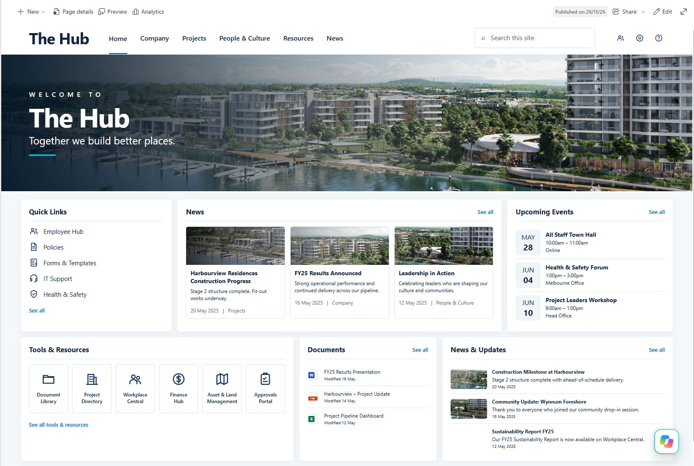
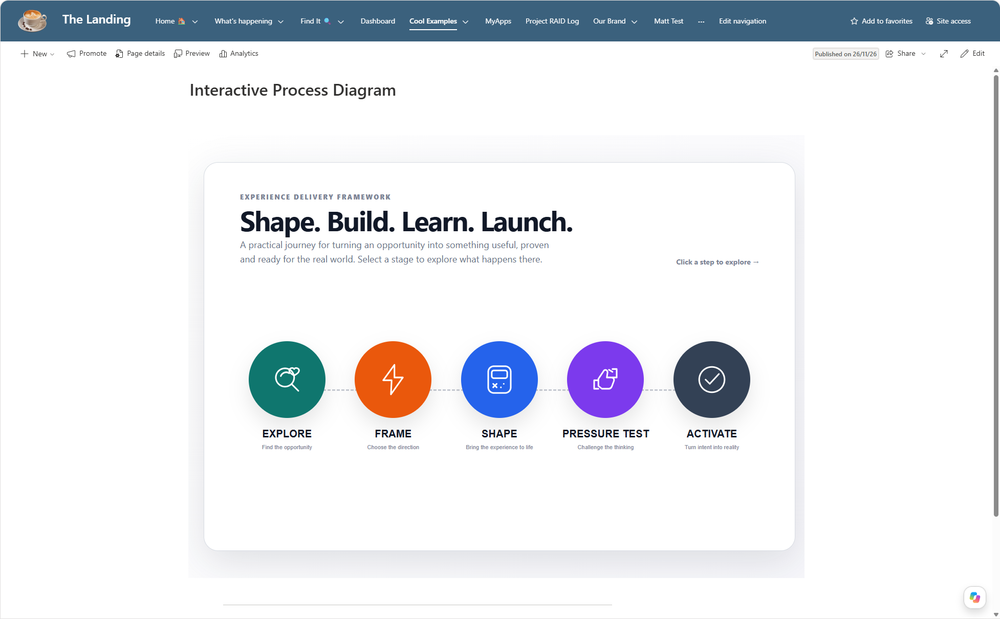
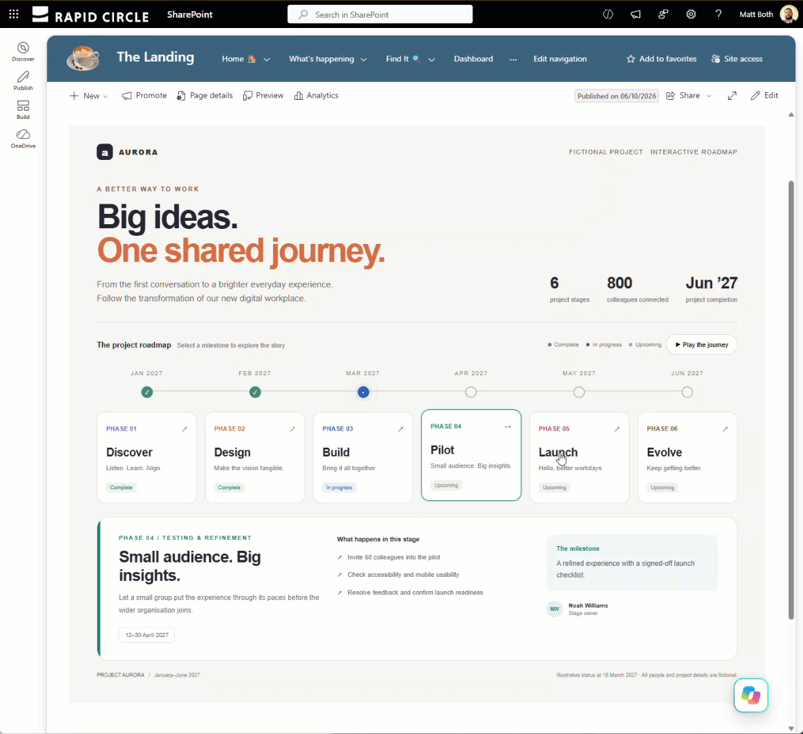
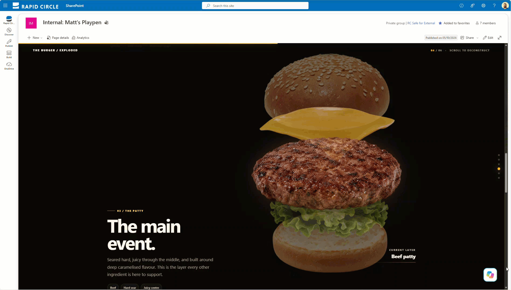
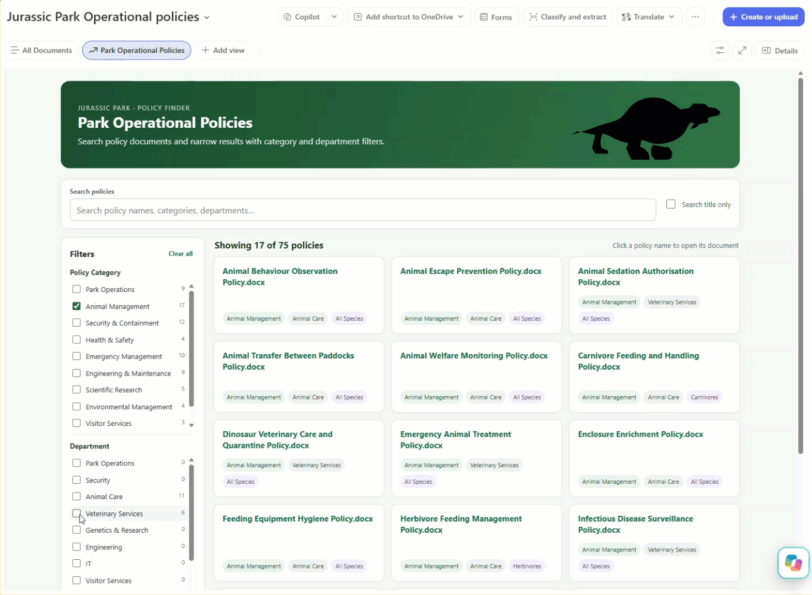
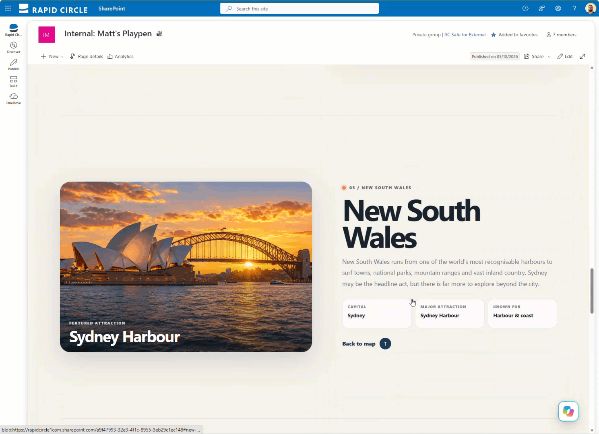
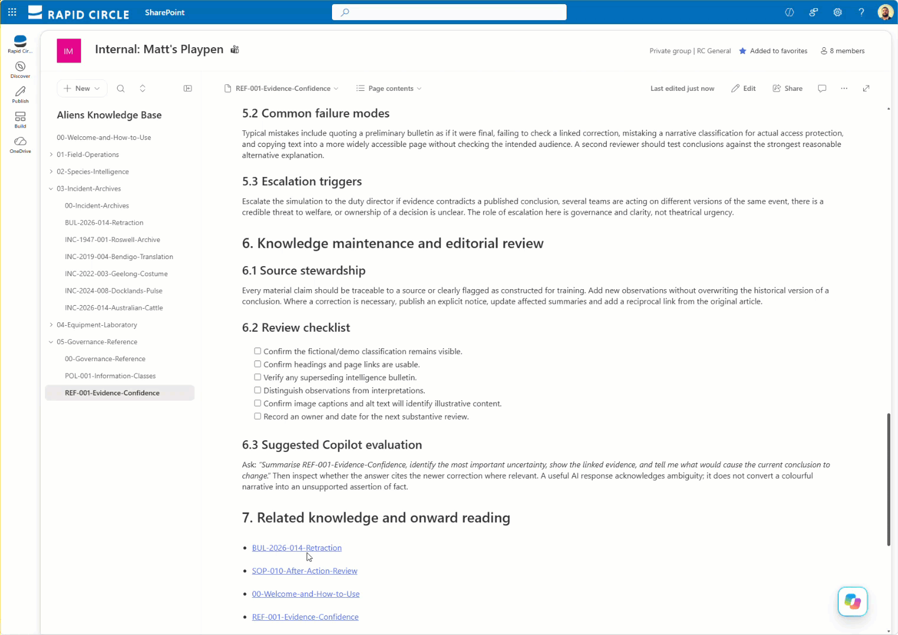

# SharePoint Showcase

A collection of things I've built in SharePoint. Each item has its own page with a screenshot and description.

| Project | Description |
|---|---|
|  | **[The Hub](pages/the-hub.md)** – Corporate intranet home page with news, events, quick links and tools. |
|  | **[Interactive Feature Tour](pages/interactive-feature-tour.md)** – Explore a performance car through glowing hotspots revealing design and engineering details. |
|  | **[Interactive Process Diagram](pages/interactive-process-diagram.md)** – Clickable five-stage framework diagram embedded in a SharePoint page. |
|  | **[Interactive Project Timeline](pages/project-timeline.md)** – Clickable project roadmap with phases, milestones and a "play the journey" mode. |
|  | **[The Burger, Exploded](pages/burger.md)** – Scroll-driven storytelling page that deconstructs a burger layer by layer. |
|  | **[Policy Finder](pages/doclibrary.md)** – Document library with search, faceted filters and a card-based results view. |
|  | **[Explore Australia](pages/explore-aus.md)** – Interactive map that opens rich destination stories for each state. |
|  | **[Aliens Knowledge Base](pages/knowledge-base.md)** – Structured, Copilot-ready knowledge base using the new SharePoint Knowledge Base (preview). |