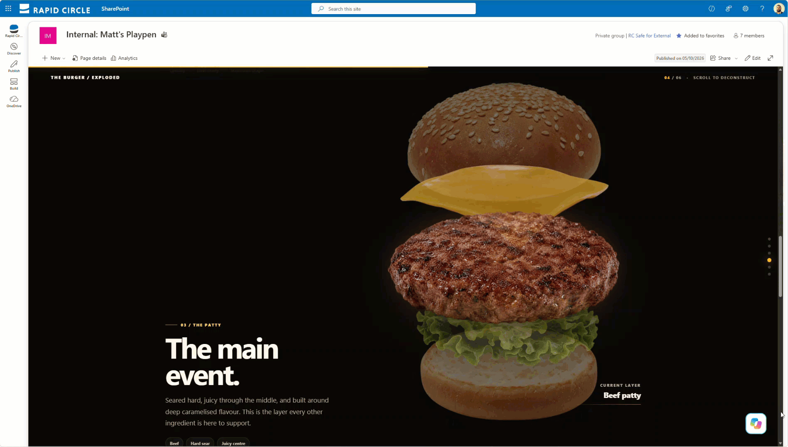

# The Burger, Exploded (Scroll-driven Storytelling)

## Demo

## Overview
A cinematic, scroll-driven page on a SharePoint team site that "deconstructs" a burger layer by layer. As the visitor scrolls, the burger separates into its components, and each layer gets its own headline, description and tags. It demonstrates how SharePoint pages can go well beyond standard layouts and deliver an immersive, product-launch style experience.

## Highlights
- **Scroll to deconstruct:** the burger explodes into six layers as you scroll (bun, cheese, patty, lettuce and more).
- **Layer story panels** with a numbered chapter label (e.g. "03 / The Patty"), headline, copy and descriptive tags such as *Beef*, *Hard sear* and *Juicy centre*.
- **Live progress indicators:** a "04 / 06" counter, side navigation dots and a "Current layer" label.
- **Dark, full-bleed design** with striking photography, bold typography and smooth animation.
- Embedded natively in a modern SharePoint page on the *Internal: Matt's Playpen* site.

## Built with
SharePoint Online modern page with custom HTML/CSS/JavaScript for scroll-triggered animation.

[← Back to showcase](../README.md)
