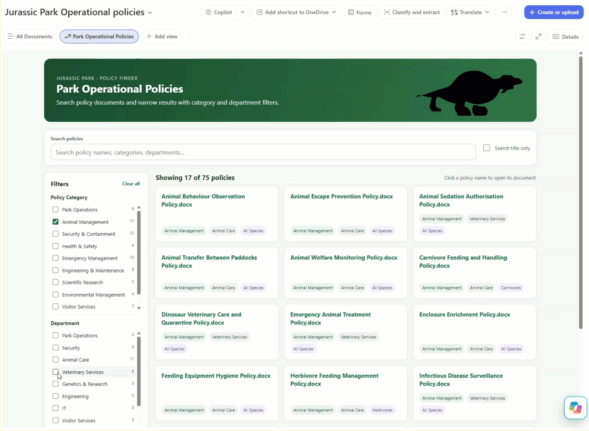
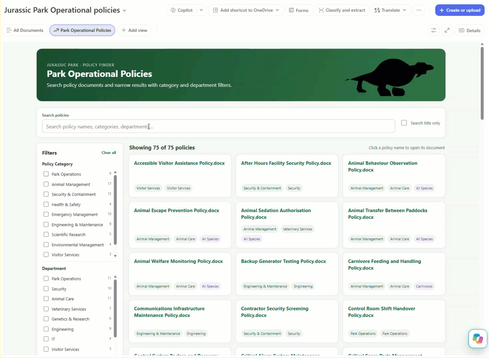

# Policy Finder: Enhanced Document Library View

## Demo

## Overview
A document library view transformed into a searchable, filterable "policy finder". Using the fictional *Jurassic Park Operational Policies* library (75 policy documents), it replaces the standard list with a branded banner, instant search and a card-based results grid, making it far easier to find the right document.

## Highlights
- **Custom view** ("Park Operational Policies") alongside the standard All Documents view, inside the library itself.
- **Live search** across policy names, categories and departments, with a "search title only" option.
- **Faceted filters** for Policy Category (Park Operations, Animal Management, Security & Containment, Health & Safety and more) and Department, each with live counts.
- **Result cards** showing the document name with colour-coded metadata tags and a live "Showing 17 of 75 policies" count.
- **Click-through** to open the policy document directly.
- Works with the library's built-in tools (Copilot, Forms, Classify and extract, Translate).

## Built with
SharePoint Online document library with a custom-formatted view and an embedded custom UI driven by the library's metadata columns. All policies shown are fictional.

[← Back to showcase](../README.md)
