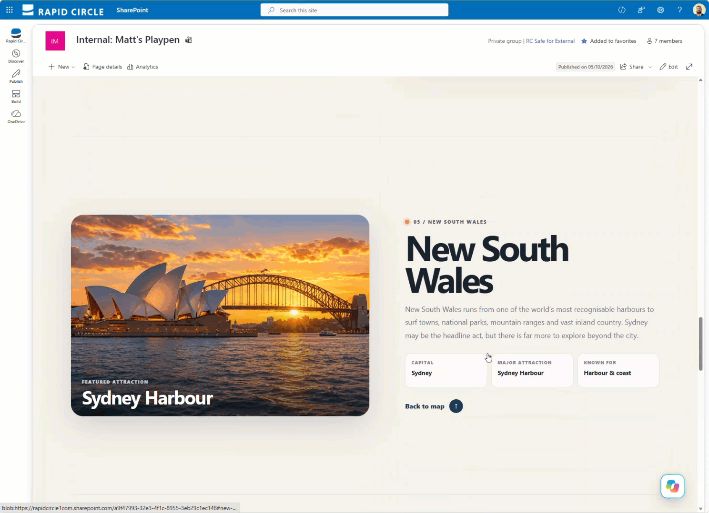

# Explore Australia: Interactive Map & Destination Stories

## Demo

## Overview
An interactive "Explore Australia" experience on a SharePoint team site. Visitors pick a state or territory from a map and are taken to a rich destination story, with a "Back to map" button to return and keep exploring. It shows how SharePoint pages can deliver a polished, travel-brochure style experience with no external tooling.

## Highlights
- **Map-driven navigation** to jump into each state or territory story.
- **Numbered destination chapters** (e.g. "05 / New South Wales") with a bold headline and an engaging intro.
- **Featured attraction** card with full-bleed photography (e.g. Sydney Harbour).
- **Quick-fact tiles** for Capital, Major attraction and Known for.
- **"Back to map"** control for smooth, single-page navigation.
- Warm, editorial design with smooth scroll and transition effects, embedded natively in a modern SharePoint page on the *Internal: Matt's Playpen* site.

## Built with
SharePoint Online modern page with custom HTML/CSS/JavaScript for the interactive map and animations.

[← Back to showcase](../README.md)
