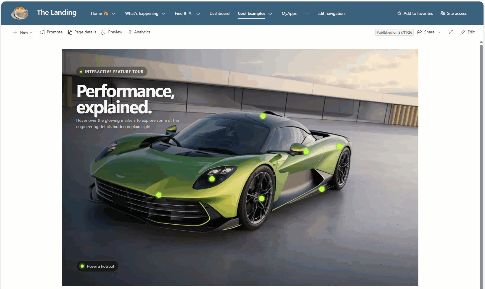

# Interactive Feature Tour

## Demo

## Overview
An interactive feature tour built with **100% custom HTML** for SharePoint Online. Using a high-performance sports car as the centrepiece, the page invites visitors to explore its design and engineering through glowing, clickable hotspots. Rather than presenting features in a long list, it lets people discover them directly on the image, creating a more engaging and visual experience.

## Highlights
- **Interactive hotspots** placed across the car to highlight individual features.
- **Glowing markers** make points of interest easy to discover.
- **Feature details on hover** give visitors information in context without navigating away.
- **Immersive visual design** combines a full-width image, bold typography and subtle overlays.
- **Self-guided exploration** encourages visitors to interact with the content at their own pace.

## Built with
SharePoint Online modern page with 100% custom HTML/CSS/JavaScript for the interactive image and feature hotspots.

[← Back to showcase](../README.md)
