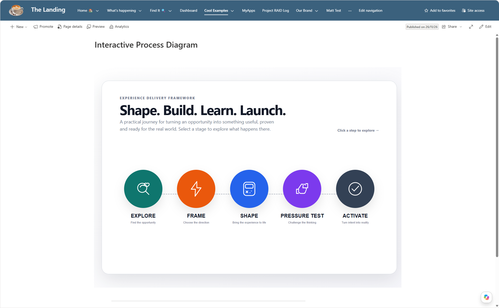
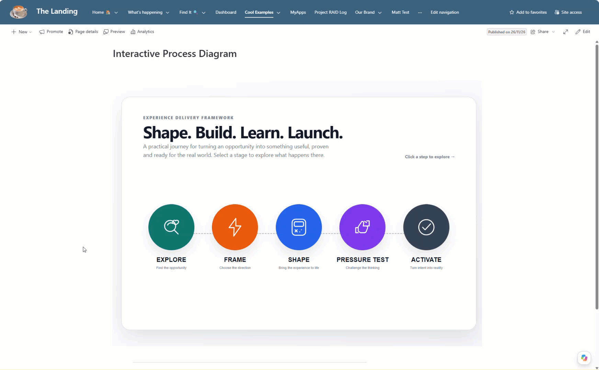

# Interactive Process Diagram

## Demo

## Overview
An interactive, animated process diagram embedded in a SharePoint page on "The Landing" site (under the *Cool Examples* menu). It presents an **Experience Delivery Framework**, "Shape. Build. Learn. Launch.", as a five-stage journey that visitors can click through to explore each stage.

## The stages
| Stage | Purpose |
|---|---|
| **Explore** | Find the opportunity |
| **Frame** | Choose the direction |
| **Shape** | Bring the experience to life |
| **Pressure Test** | Challenge the thinking |
| **Activate** | Turn intent into reality |

## Highlights
- Colour-coded circular nodes with icons, joined by a dotted connector line.
- "Click a step to explore" interaction reveals what happens at each stage.
- Clean card layout with a bold headline and short intro that sits natively within a modern SharePoint page.

## Built with
SharePoint Online modern page with custom HTML/CSS/JavaScript for the interactive diagram.

[← Back to showcase](../README.md)
