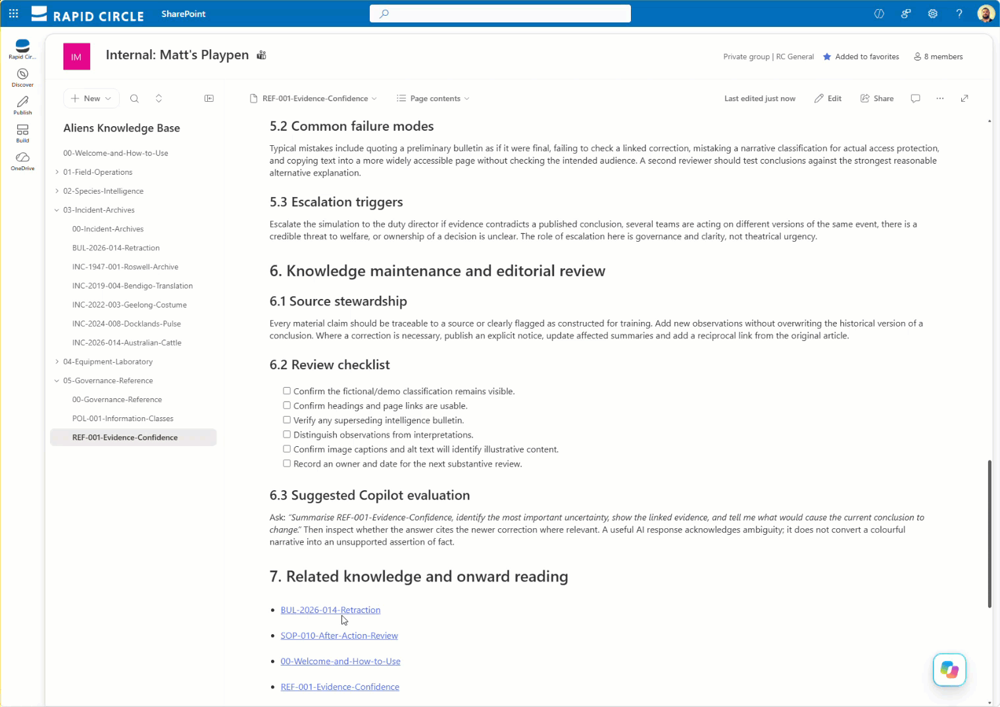
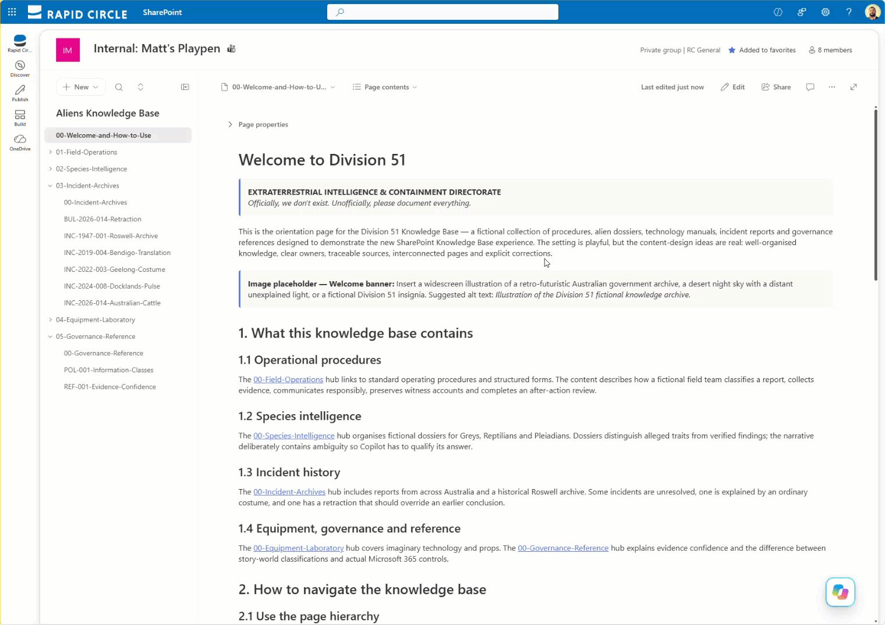

# Aliens Knowledge Base (SharePoint Knowledge Base)

## Demo

## Overview
A structured, navigable knowledge base built with the new **SharePoint Knowledge Base** (preview) feature. It uses a fictional "Aliens Knowledge Base" as demo content to show how a large body of reference material can be organised as a connected set of pages with a persistent navigation tree, instead of a flat library of documents.

Learn more: [Get started with SharePoint Knowledge Base (preview), Microsoft Support](https://support.microsoft.com/en-us/sharepoint/knowledge-base/get-started-with-sharepoint-knowledge-base)

## Highlights
- **Hierarchical navigation tree** with numbered sections: Welcome and How to Use, Field Operations, Species Intelligence, Incident Archives, Equipment Laboratory and Governance Reference.
- **Rich article pages** with numbered headings, review checklists, escalation triggers and a "Related knowledge and onward reading" section of cross-links.
- **In-page contents** menu for jumping between sections of long articles.
- **Structured content conventions** such as source stewardship, editorial review checklists and evidence-confidence ratings that keep the knowledge trustworthy.
- **Built for Copilot:** articles include suggested Copilot evaluation prompts, showing how well-structured knowledge can ground accurate, cited AI answers.
- All content is fictional and created for demonstration.

## Built with
SharePoint Knowledge Base (preview) on a SharePoint team site, with Copilot-ready content design.

[← Back to showcase](../README.md)
