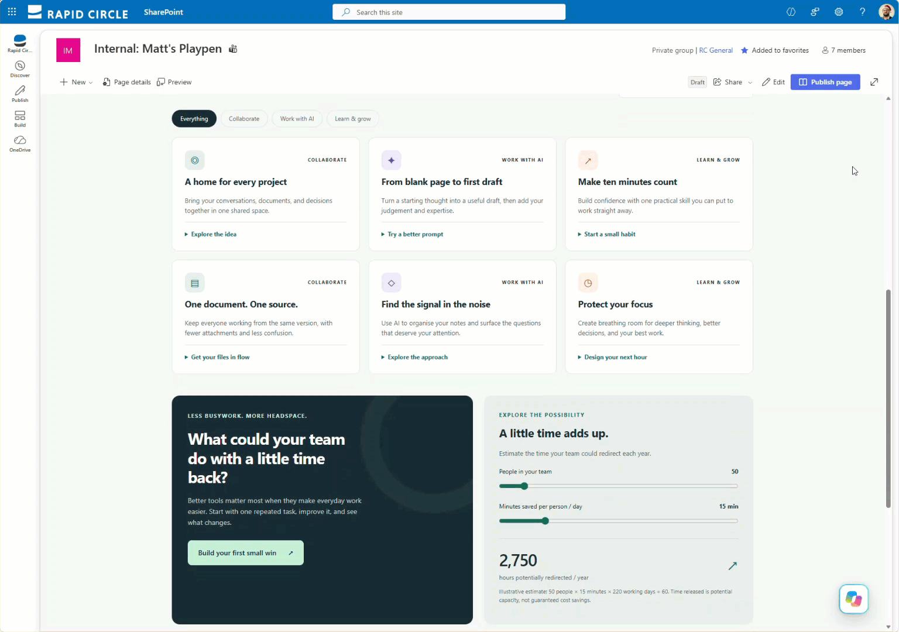
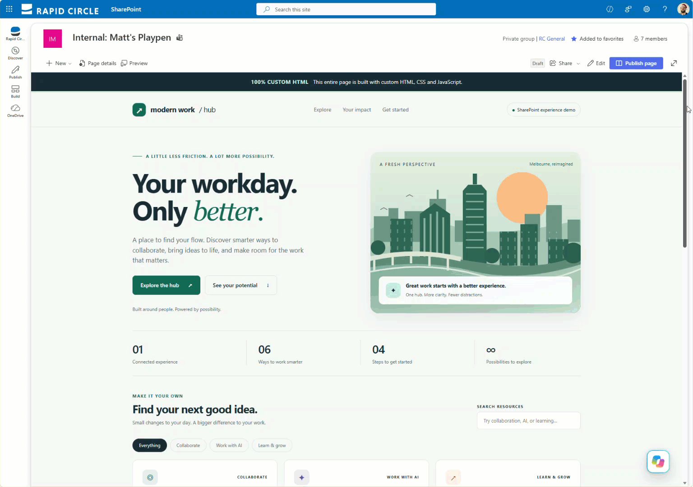

# Modern Work Hub

## Demo

## Overview
An interactive "modern work" hub page that helps teams discover practical ways to collaborate, work with AI and keep learning. Visitors filter a grid of idea cards by theme and can even estimate the time their own team could win back.

## Highlights
- **Filter pills:** Everything, Collaborate, Work with AI and Learn & grow.
- **Idea cards** with icon, category label, short description and a call to action (e.g. "Try a better prompt", "Design your next hour").
- **Time-saving calculator:** sliders for team size and minutes saved per person per day produce a live estimate of hours redirected per year (e.g. 2,750).
- **Clear caveat** that the estimate is illustrative, not a guaranteed saving.
- Calm dark-and-light card design that sits natively in a modern SharePoint page.

## Built with
SharePoint Online modern page with custom HTML/CSS/JavaScript for filtering and the calculator.

[← Back to showcase](../README.md)
