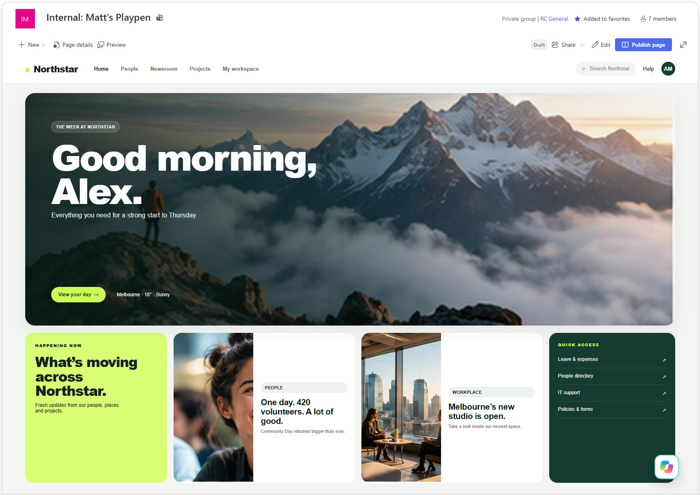

# Northstar: Modern Intranet Home

## Overview
Northstar is a contemporary, personalised intranet home page concept for a fictional organisation, built on a SharePoint team site. It swaps the usual grid of web parts for a bold, editorial layout that greets each employee and puts what matters most front and centre.

## Highlights
- **Personal greeting hero:** "Good morning, Alex." with a dramatic full-width image, a "View your day" call to action and live local weather.
- **Clean top navigation:** Home, People, Newsroom, Projects and My workspace, with search and help built in.
- **Happening now** highlight tile pointing to the latest updates across the organisation.
- **Story cards** for People and Workplace news, combining photography, category labels and short headlines.
- **Quick access** panel for Leave & expenses, People directory, IT support and Policies & forms.
- Vibrant lime and deep green brand palette with rounded cards for a modern feel.

## Built with
SharePoint Online modern page with custom HTML/CSS/JavaScript. All names and content are fictional.

[← Back to showcase](../README.md)
