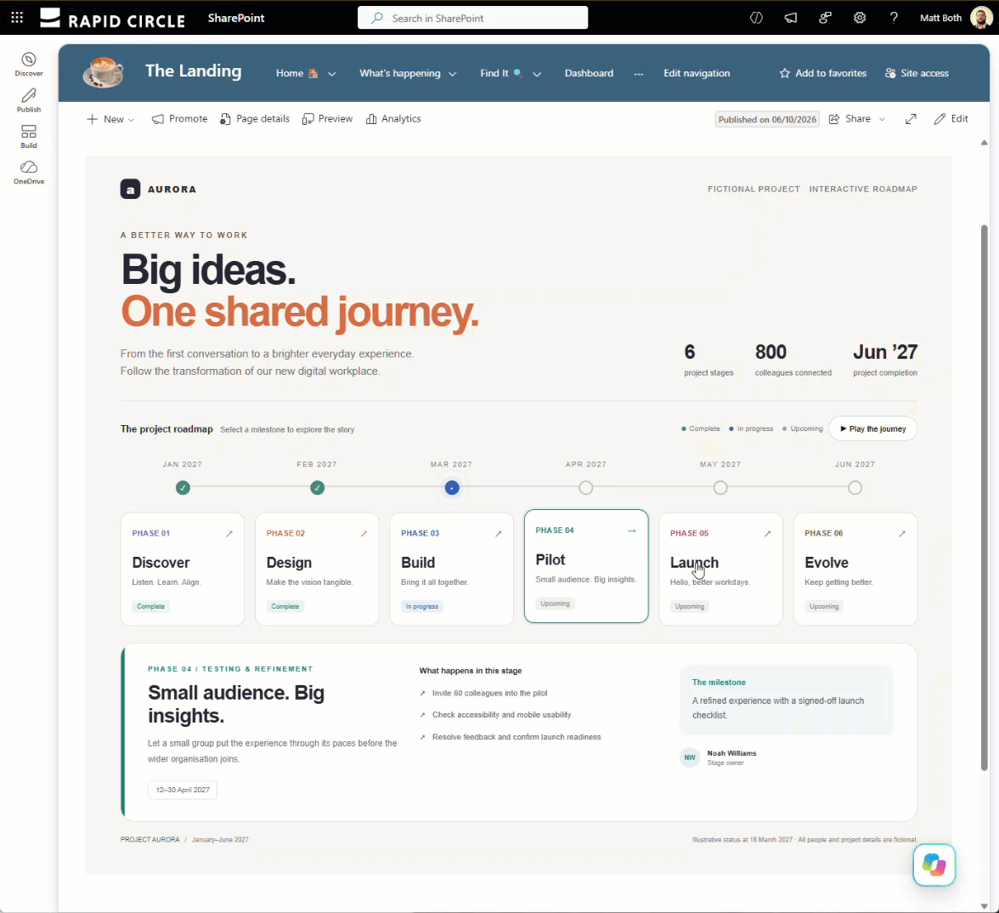
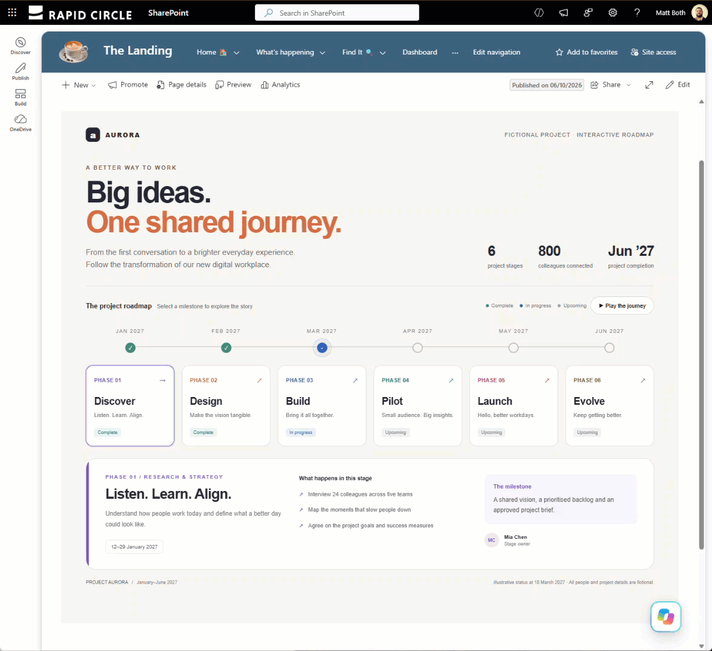

# Interactive Project Timeline

## Demo

## Overview
An interactive project roadmap embedded in a SharePoint page on "The Landing" site. It uses a fictional example, **Project Aurora** ("Big ideas. One shared journey."), to show how a project's story, status and milestones can be presented in a far more engaging way than a static list or Gantt chart.

## Highlights
- **Headline stats** summarising the project: 6 stages, 800 colleagues connected, completion in Jun '27.
- **Visual timeline** from Jan to Jun 2027 with Complete, In progress and Upcoming status markers.
- **Six phase cards:** Discover, Design, Build, Pilot, Launch and Evolve, each with a tagline and a status chip.
- **Click-to-explore detail panel** showing the stage description, what happens in the stage, key dates, the milestone and the stage owner.
- **"Play the journey"** button that auto-plays through each phase.
- Clean, branded design that sits natively within a modern SharePoint page.

## Built with
SharePoint Online modern page with custom HTML/CSS/JavaScript for the interactive timeline. All project and people details shown are fictional.

[← Back to showcase](../README.md)
