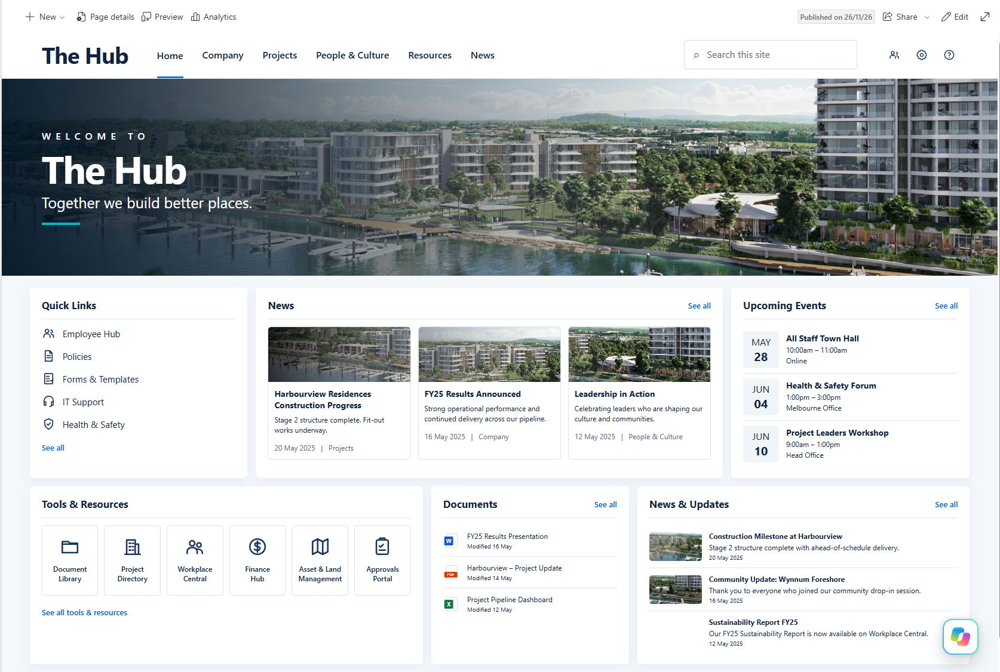

# The Hub – Corporate Intranet Home

## Overview
The Hub is a modern intranet home page built on SharePoint Online for a property development and construction business ("Together we build better places."). It gives every employee a single starting point for company news, events, tools and documents.

## Highlights
- **Branded hero banner** with a welcome message and tagline over project imagery.
- **Mega-menu style navigation:** Home, Company, Projects, People & Culture, Resources, News.
- **Quick Links** to the Employee Hub, Policies, Forms & Templates, IT Support and Health & Safety.
- **News cards** with category tags (Projects, Company, People & Culture) and publish dates.
- **Upcoming Events** with date tiles, times and locations (e.g. All Staff Town Hall, Health & Safety Forum).
- **Tools & Resources tiles** for Document Library, Project Directory, Workplace Central, Finance Hub, Asset & Land Management and Approvals Portal.
- **Documents web part** showing recent Word, PDF and Excel files.
- **News & Updates feed** with thumbnails for the latest announcements.

## Built with
SharePoint Online communication site, Quick Links, News, Events, Hero and Document Library web parts, and site navigation.

[← Back to showcase](../README.md)
