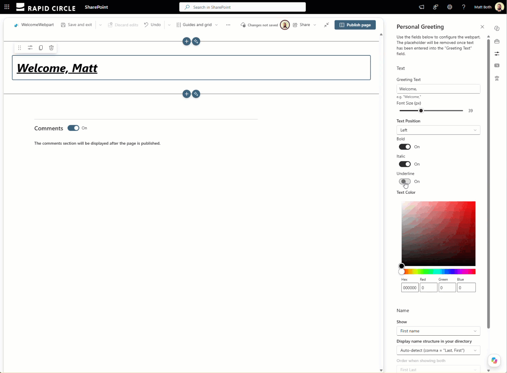

# Personal Greeting Web Part (SPFx)

## Demo

## Overview
A custom **SharePoint Framework (SPFx)** web part that greets each visitor by name, for example "Welcome, Matt". Page authors configure the look and feel from the property pane, so the same web part can be dropped into any page and styled to suit.

## Highlights
- **Personalised** greeting that picks up the signed-in user's name.
- **Name options:** show first name, last name or both, with support for different directory name formats (including auto-detect of "Last, First").
- **Greeting text** is fully editable (e.g. "Welcome,").
- **Styling controls:** font size slider, text position, bold, italic, underline and a full colour picker.
- Changes preview instantly in the page editor.

## Built with
SharePoint Framework (React), packaged as an `.sppkg` solution for the App Catalog.

[← Back to showcase](../README.md)
